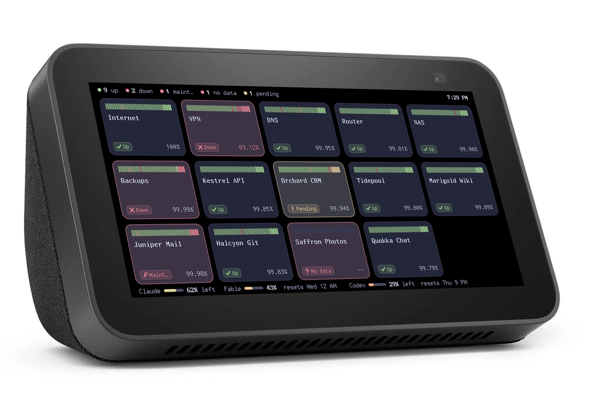
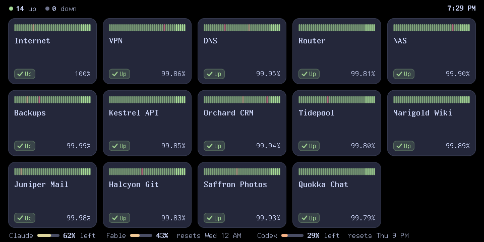

# Echo Kuma Board

An always-on Android wall display for one public [Uptime Kuma](https://github.com/louislam/uptime-kuma)
status page, built for an Echo Show 5 (2nd gen, `cronos`) running LineageOS 18.1 (Android 11, 960×480).
Every monitor fits on one screen. There is no scrolling, no login and no menus.

Spec: [docs/PRD.md](docs/PRD.md).





Screenshots of the real app in an Android 11 emulator at 960×480, using demo data with made-up service names. The top image places that screenshot onto Amazon's product photo of the Echo Show 5 (2nd gen); `tools/mockup/echo_frame.py` draws a plain front-facing frame instead.

## What it does

- Reads `GET /api/status-page/<slug>` and `GET /api/status-page/heartbeat/<slug>` every 30 s
  (10–300 s). It needs no credentials and does not depend on Kuma's page markup.
- Chooses the grid automatically: 14 monitors give a 5×3 grid of 176×135 px tiles. Above 20
  monitors it pages every 15 s and shows page dots.
- A permanent status bar, styled like iOS, sits at the top. On the left it shows the counts
  ("● 9 up  ● 2 down  ● 1 maint.  ● 1 no data  ● 1 pending"; categories at zero are hidden
  except up and down). On the far right it shows the clock, preceded by "Offline · updated hh:mm"
  when the data is stale.
- Each tile has full-width heartbeat bars across the top, then the name in bold (2 lines when
  the tile is tall enough, otherwise 1), then a bottom row with the status chip on the left and
  the 24 h uptime right-aligned in smaller regular text. **Red** means down (✕), maintenance (wrench) or
  no data (?). **Yellow** means pending (!). **Green** means up. Non-green tiles get a tint, a
  stronger border and their marker, so the three red states can be told apart without relying
  on colour.
- Spare grid cells stay empty, leaving room for new monitors.
- When fetches fail, the board keeps the last good data, dims it and shows
  "Offline · updated hh:mm" in the status bar. Retries back off exponentially up to 60 s and restart
  immediately when Wi-Fi reconnects.
- Kiosk behaviour: the Android status bar and Back/Home/Recents bar are hidden on every app screen (an edge swipe shows them briefly, then they hide again), screen kept on, Back ignored, selectable as the Home
  app, starts on boot, restarts itself after a crash, and a watchdog restarts the app if the UI
  or the refresh loop stalls.
- Quacks (the bundled `quack.wav`) once when a server has been down for more than 5 minutes,
  never 22:00–09:00 Pacific; switch and quiet hours are in Settings.
- A night window (default 23:00–07:00) lowers brightness, switches the canvas to Crust and
  desaturates accents. Full brightness returns whenever something is down.
- The whole board shifts by a few pixels every 3 minutes to limit burn-in.
- Uses the Catppuccin Macchiato palette and the bundled [Greybeard](https://github.com/flowchartsman/greybeard)
  bitmap font, drawn only at its native pixel sizes (or whole multiples) so it stays crisp. Every colour
  comes from one token table, and WCAG contrast is checked in unit tests.

## Settings

Long-press the **top-left corner for 1.5 s**. A normal tap does nothing.

### Provisioning without typing (F23)

Option 1: a JSON file, applied whenever its modification time changes:

```sh
cat > kuma-board.json <<'EOF'
{
  "url": "https://kuma.example.com/status/echo",
  "refreshSeconds": 30,
  "sort": "kuma",
  "columns": 0,
  "dim": { "enabled": true, "start": "23:00", "end": "07:00", "level": 8 },
  "sound": false
}
EOF
adb push kuma-board.json /sdcard/Android/data/dev.kumaboard/files/
```

Option 2: an adb broadcast, which prints `ok: …` or `error: …`:

```sh
adb shell am broadcast -n dev.kumaboard/.ProvisionReceiver -a dev.kumaboard.PROVISION \
  --es url https://kuma.example.com/status/echo --ei refreshSeconds 30 --es sort problems
```

Accepted keys: `url` (a full status page URL or a base URL), `slug`, `refreshSeconds`,
`sort` (`kuma` | `problems`), `columns` (0 = auto), `dimEnabled`, `dimStart`, `dimEnd`,
`dimLevel` (percent), `sound`, `combine`, `rename`, `hide`, `order`, `usageUrl`, or `json` containing the whole document. The receiver requires
`android.permission.DUMP`. The adb shell has that permission and ordinary apps cannot get it,
so other apps on the device cannot reconfigure the board.

### Combined tiles and display layout

Show several monitors as one tile, and rename, hide or reorder tiles without changing Kuma.
Add these keys to `kuma-board.json` (or send them with `--es json '…'`):

```json
{
  "combine": [
    { "name": "DNS",  "members": ["DNS 1", "DNS 2"], "mode": "any", "group": "DNS" },
    { "name": "Auth", "members": ["login", "tokens"], "mode": "all" }
  ],
  "rename": { "Internet (ISP)": "Internet" },
  "hide":   ["Hypervisor UI"],
  "order":  ["Internet", "VPN", "DNS", "Router", "NAS"]
}
```

- `mode: any`: up if any member is up (redundant services). `mode: all`: down if any member is down.
- `group`: the name of a Kuma group monitor holding the members. When it is on the status page
  the tile shows the group's own status and the members are left off.
- A member matches a monitor with that exact name, or whose last ` - ` part is that name
  (`tokens` matches `Auth - tokens`). Case and extra spaces are ignored.

### Weekly AI usage strip (optional)

A thin strip along the bottom can show how much of your weekly Claude and Codex plan is left.
It reads a numbers-only JSON file published by a small collector on the computer where you use
those tools; see [tools/ai-usage/README.md](tools/ai-usage/README.md). Set `usageUrl` to show it.

Address rules: HTTPS only. Plain `http://` is accepted only for private-network hosts
(RFC 1918, 100.64/10, `*.lan`, `*.local`, `*.ts.net`, single-label names). The app never
follows a redirect from https to http.

## Build (command line, no Android Studio)

Requires JDK 17 and an Android SDK with `platforms;android-35` and `build-tools;35.0.0`.

```sh
export JAVA_HOME=…/jdk-17 ANDROID_HOME=…/android-sdk   # or put sdk.dir in local.properties
./gradlew :core:test          # pure-JVM unit tests: layout, parser, policies, contrast
./gradlew :app:assembleDebug  # app/build/outputs/apk/debug/app-debug.apk
./gradlew :app:lintDebug
```

Release signing: run `tools/sign-release.sh` after `./gradlew :app:assembleRelease`, or create a git-ignored `keystore.properties` with `storeFile`,
`storePassword`, `keyAlias` and `keyPassword`, then run `./gradlew :app:assembleRelease`
(about 200 KB, minified). Without that file the release APK is unsigned.

## The device: LineageOS on the Echo Show 5

The Echo in the picture runs LineageOS instead of Amazon's Fire OS. It has been unlocked and
flashed with the unofficial **LineageOS 18.1 (Android 11) build for the Echo Show 5 2nd gen
(`cronos`)**, build `lineage-18.1-20260624-UNOFFICIAL-cronos` (release v0.3). The board was
developed and tested on that build.

- **Download the OS image:** [amazon-oss/releases, cronos builds](https://github.com/amazon-oss/releases/releases?q=cronos)
  (the build above is [lineage-18.1-cronos-v0.3](https://github.com/amazon-oss/releases/releases/tag/lineage-18.1-cronos-v0.3);
  newer builds are listed there too).
- **Unlock, TWRP and flashing:** [XDA unlock/root/TWRP thread for `cronos`](https://xdaforums.com/t/unlock-root-twrp-unbrick-amazon-echo-show-5-2nd-gen-2021-cronos.4772596/)
  and the [XDA LineageOS 18.1 thread for `cronos`](https://xdaforums.com/t/rom-unofficial-11-cronos-lineageos-18-1-for-the-amazon-echo-show-5-2021.4772598/).
  A step-by-step walkthrough: [Hacking your Echo Show 5 and 8](https://www.derekseaman.com/2025/11/home-assistant-hacking-your-echo-show-5-and-8.html).

Other models need their own build: Echo Show 5 1st gen is `checkers`, Echo Show 8 1st gen is
`crown`. Unlocking and flashing can brick the device and is at your own risk; follow the
threads exactly.

## Install on the Echo (after LineageOS is flashed)

```sh
adb install -r app-release.apk
adb shell cmd package set-home-activity dev.kumaboard/.BoardActivity   # make it the Home app (F17)
# Only needed if it is NOT the Home app, so boot and crash recovery can bring it to the front:
adb shell appops set dev.kumaboard SYSTEM_ALERT_WINDOW allow
```

Keep Tailscale connected from boot (Always-on VPN, lockdown off so local traffic still works
if Tailscale is down), and keep both apps out of battery optimisation:

```sh
adb shell settings put secure always_on_vpn_app com.tailscale.ipn
adb shell settings put secure always_on_vpn_lockdown 0
adb shell dumpsys deviceidle whitelist +com.tailscale.ipn
adb shell dumpsys deviceidle whitelist +dev.kumaboard
```

Or open Settings → **Set as Home app** on the device. To leave the kiosk, use Settings →
**Android settings**.

### Debug demo mode

Debug builds can show sample data, so you can check the layout without a server:

```sh
adb shell am start -n dev.kumaboard/.BoardActivity --ez demo true --es demoScenario down   # 16 sample monitors; --ei demoCount N for more or fewer
# scenarios: ok | down | nodata | stale ; --ez demo false returns to live data
```

## Layout

```
core/   Pure Kotlin (JVM): Kuma JSON parser, grid layout function, sort/staleness/backoff/
        night-window policies, config validation and provisioning, palette and tile recipes.
        All unit-tested without Android.
app/    Android: BoardActivity (kiosk + loops), BoardView (one canvas, no per-tile views),
        KumaClient (OkHttp), SettingsActivity, Boot/Provision receivers, crash recovery.
```

## Licence

Code: MIT (see [LICENSE](LICENSE)). Font: Greybeard v1.0.0 by Andy Walker, based on UW ttyp0
by Uwe Waldmann, MIT (`app/src/main/assets/fonts/greybeard/LICENSE.txt`). The bundled files are
subset to Latin and punctuation.
